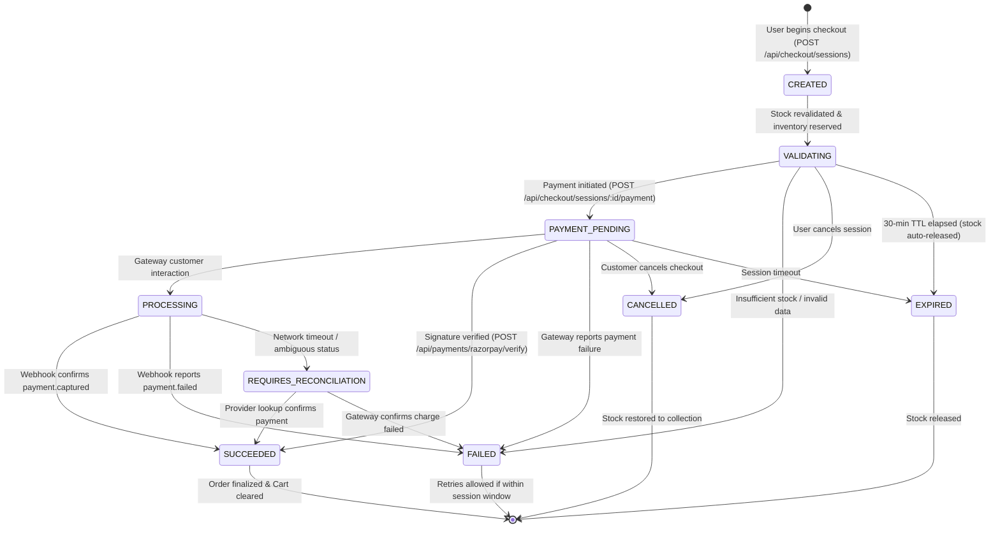

# ORIVELLE Atelier — Production E-Commerce Architecture

Production-grade authentication, server-authoritative checkout sessions, cryptographic payment security with Razorpay, and order lifecycle management for the ORIVELLE clothing storefront.

---

## 1. Architecture Overview

ORIVELLE Atelier is built with a decoupled React 19 + TypeScript frontend (Vite & Tailwind CSS) and a hardened Node.js Express 5 backend with transactional database persistence.

### Core Architectural Pillars
- **Authentication**: Password hashing powered by **Argon2id** (`@node-rs/argon2`) with backwards-compatible legacy bcrypt verification and auto-upgrades. Secure, HttpOnly, SameSite session cookies with token hashing (SHA-256), session rotation on privilege escalation, email verification, and single-use password reset tokens with account enumeration defense.
- **Server-Authoritative Pricing**: Zero floating-point monetary arithmetic. All amounts are calculated and stored in **integer minor units (paise in INR)**. Product variant prices, coupon discounts, shipping thresholds, and tax are re-verified exclusively on the server at checkout.
- **Checkout Session Lifecycle**: Dedicated `CheckoutSession` model strictly bound to the owner, separating the shopping cart from the payment session. Atomically reserves local inventory with automatic timeout expiration and cleanup.
- **Idempotency & Concurrency**: Application and database-level idempotency (`idempotency_records`) using canonical SHA-256 request fingerprinting, database-enforced unique constraints, concurrent in-flight detection (`409 Conflict`), and safe replay caching.
- **Payment Gateway (Razorpay)**: Full server-side payment lifecycle with server-authoritative order creation, cryptographic HMAC-SHA256 signature verification (`crypto.timingSafeEqual`), and deduplicated webhook processing.
- **Dual Database Support**: Fully modeled in `prisma/schema.prisma` for managed PostgreSQL deployments, backed by an embedded WAL-enabled SQLite engine (`node:sqlite DatabaseSync`) for zero-dependency local execution and automated testing.

---

## 2. Checkout & Payment State Machine



---

## 3. Ambiguous Payment Outcome & Recovery Policy

In real-world payment systems, network failures, gateway latency, browser crashes, and delayed webhook deliveries can leave payment attempts in ambiguous states. The system applies the following recovery policy:

1. **No False Failures**: A checkout session is never marked as `FAILED` solely because a client-side HTTP request timed out. If the gateway may have received or processed funds, the session moves to `REQUIRES_RECONCILIATION`.
2. **Same-Session Payment Protection**: Once a Razorpay provider order is generated for a checkout session, repeat payment requests for the same session reuse the existing provider order. No duplicate charges or orphan provider orders are created.
3. **Idempotent Webhook Reconciliation**: Webhooks (`payment.captured`) are processed transactionally. If the frontend payment verification callback was delayed or dropped, the webhook finalizes the order, credits stock deduction, and transitions the session to `SUCCEEDED`.
4. **Late Capture Handling**: If a payment capture event arrives after a customer abandons the browser, the webhook verifies the raw HMAC signature, recovers the session, records the payment in `payment_attempts`, and finalizes the order without requiring client action.
5. **Inventory Protection**: Reserved inventory is held during `PAYMENT_PENDING` and `PROCESSING`. If a session definitively expires without payment confirmation, `cleanupExpiredSessions` restores stock atomically to the variant pool.

---

## 4. API Specification

| Endpoint | Method | Auth | Description |
|---|---|---|---|
| `/api/auth/register` | POST | Public | Register with Argon2id password hash & issues verification token |
| `/api/auth/login` | POST | Public | Authenticates credentials, rotates session cookie, migrates legacy hashes |
| `/api/auth/logout` | POST | Public | Revokes session from database & clears cookie |
| `/api/auth/forgot-password` | POST | Public | Issues single-use 15-min reset token (protected against enumeration) |
| `/api/auth/reset-password` | POST | Public | Validates token, sets new Argon2id password, revokes all sessions |
| `/api/auth/verify-email` | POST | Public | Validates email verification token |
| `/api/checkout/sessions` | POST | User | Creates checkout session, recalculates prices, reserves stock |
| `/api/checkout/sessions/:id` | GET | User (Owner) | Retrieves checkout session state (IDOR-protected) |
| `/api/checkout/sessions/:id/payment` | POST | User (Owner) | Atomically initiates or reuses Razorpay provider order |
| `/api/checkout/sessions/:id/cancel` | POST | User (Owner) | Cancels session and releases reserved stock |
| `/api/payments/razorpay/verify` | POST | User (Owner) | Server-side HMAC-SHA256 signature verification & order confirmation |
| `/api/webhooks/razorpay` | POST | Webhook HMAC | Raw-body signature verification, event deduplication & reconciliation |
| `/api/orders` | GET | User | Lists order history for authenticated user |
| `/api/orders/:id` | GET | User / Admin | Retrieves verified order details |
| `/api/orders/:id/cancel` | POST | User / Admin | Cancels order & restores inventory to collection |

---

## 5. Database Schema & Migration

### PostgreSQL Deployment (Prisma)
The production schema is located at `prisma/schema.prisma`. It models all relational tables, indexes, unique constraints, and enum types:
- `User` & `AuthSession`
- `PasswordResetToken` & `EmailVerificationToken`
- `Address`, `CartItem`, `Coupon`
- `CheckoutSession`, `InventoryReservation`
- `Order`, `OrderItem`, `OrderEvent`
- `PaymentAttempt`, `PaymentEvent` (webhook audit)
- `IdempotencyRecord`, `AuditLog`, `OutboxEvent`

To deploy to PostgreSQL:
```bash
npx prisma migrate dev --name init
npx prisma generate
```

### Embedded WAL SQLite
For local development, test runs, and single-instance deployments, the database layer (`server/database.ts`) automatically manages and updates `data/hanbit.sqlite` with WAL mode (`PRAGMA journal_mode = WAL; PRAGMA busy_timeout = 5000;`) and re-entrant transactions.

---

## 6. Running Locally & Verification

### Prerequisites
- Node.js 22+ or 24+
- npm

### Setup
```powershell
# Install dependencies
npm ci

# Configure environment variables
Copy-Item .env.example .env

# Run development server (frontend on 5173, backend API on 3001)
npm run dev
```

### Running Tests
The automated test suite covers all authentication, session, concurrency, idempotency, Razorpay payments, and webhook flows:
```powershell
npm test
```

### Production Build & Typecheck
```powershell
npm run build
```
Runs `tsc -b` and Vite production bundling to verify static types and bundle health.
